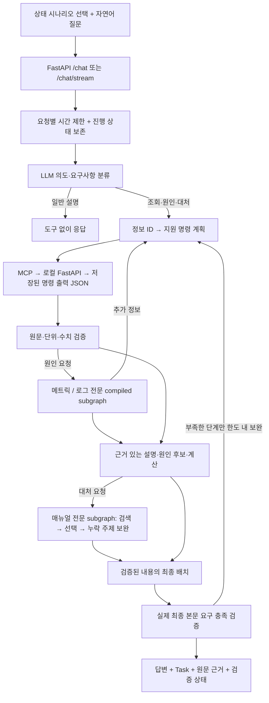
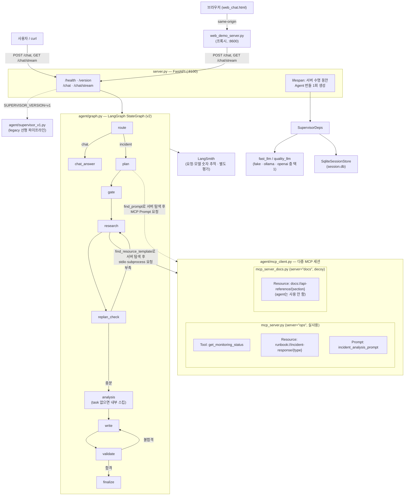
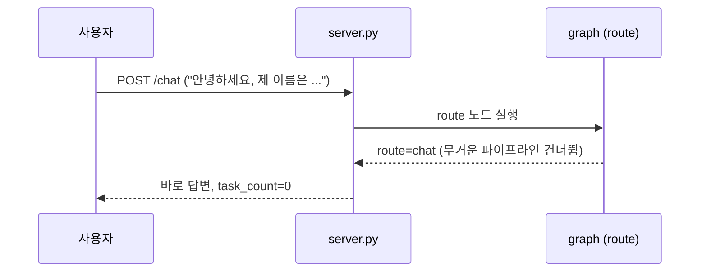
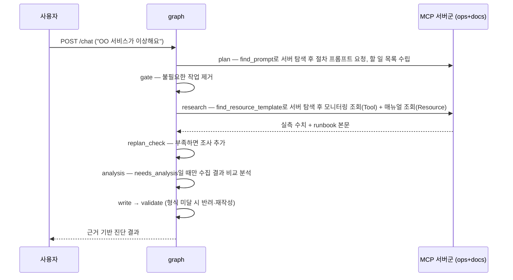
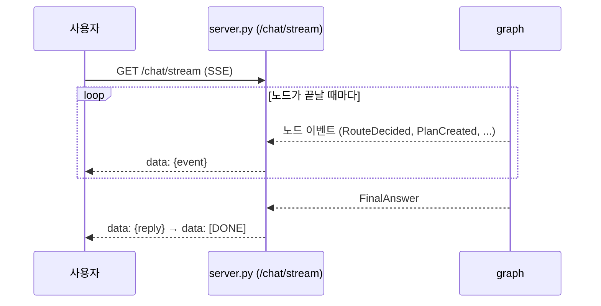
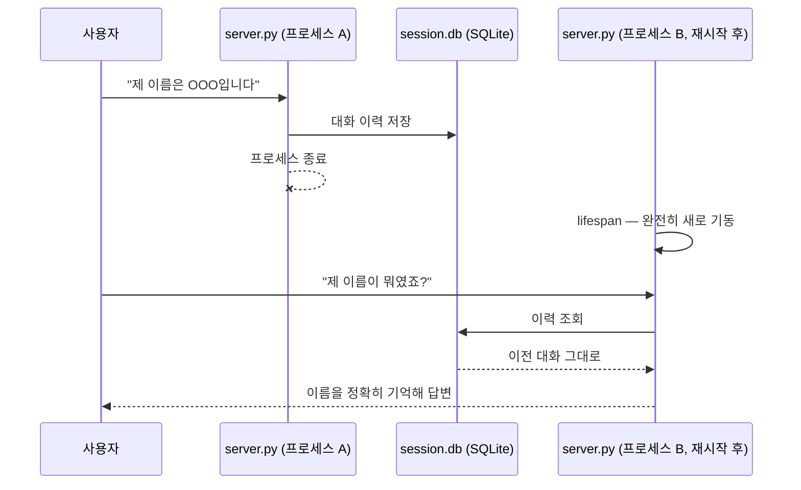
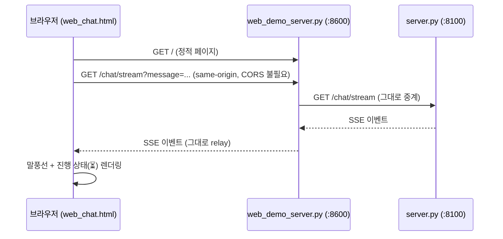

# all_total_vue — 운영 인시던트 대응 에이전트 (Vue 프론트엔드 버전)

## 현재 개선본의 범위

프론트에서 A–H 중 **한 서버의 저장된 자원 상태 시나리오**를 선택한다. A와 B는 서로 다른 운영 서버가 아니다.
예: B 상태를 선택하고 `현재 CPU 사용률과 높은 경우 원인 후보를 설명해줘`라고 요청한다.
CPU·메모리·프로세스·디스크·네트워크·로그를 정보 ID로 계획하고, 등록된 OS별 명령 출력 JSON을 MCP와 로컬 FastAPI로 조회한다.
실제 셸 실행·SSH·자동 복구는 포함하지 않는다. [조회 사용법](local_commands.md).

기존 스켈레톤의 FastAPI·Vue·MCP·LangGraph·DI·세션 기반을 확장한 버전이다.
새 기능은 정보 중심 조사, 원문·계산 검증, 공식 매뉴얼 RAG, 메트릭·로그·매뉴얼 전문 서브그래프, 전체 요구 검증이다.
메트릭·로그는 관측 판단과 추가 조회를, 매뉴얼은 검색·절차 선택·누락 주제 추가 검색을 자체 상태와 제한된 도구 범위 안에서 수행한다. 역할은 같은 모델을 공유하며 순차 실행한다.
`fake`·`ollama`·`openai` 어댑터가 있으며 이번 개선 평가의 주 모델은 `gpt-4o-mini`다.

LangSmith 추적 기반은 스켈레톤에서 계승했다. POST·SSE는 공통 요청 root와 모델 호출을 숫자 지표로 기록한다.
원문 자동 추적은 끄고 질문·답변·명령 결과는 전송하지 않는다. SSE 최종 metadata에도 요청 run ID를 제공한다.
평가 산출물의 익명 case ID·측정값·점수 전송과 로컬 원문 증빙은 구분하며, 과거 평가를 최신 코드의 성능으로 사용하지 않는다.
`cost_usd`는 설정 단가로 환산한 값이며 실제 공급자 청구 금액이 아니다. 실패한 형식 재시도의 알려진 사용량도 포함한다.

v2 `/chat`과 SSE에는 `WORKFLOW_TIMEOUT_SECONDS`(기본 120초)의 전체 그래프 실행 제한이 적용된다.
시간 초과 시 확보한 원문·검증된 답변·대처방안을 보존하고 `final_validation.status=unverified`로 반환한다.
진행 중인 동기 HTTP 호출 스레드의 즉시 중단이나 과금 취소까지 보장하지는 않는다.

## 주요 실행 방법

**맨 처음 한 번만**: 이 폴더를 처음 받았다면(학생 배포 등) `.venv`부터 만든다.

```bash
bash sh/setup_venv.sh
```

| 방법 | 명령 | 비용 | 용도 |
|---|---|---|---|
| Python 가상환경 준비 | `bash sh/setup_venv.sh` | 없음 | `.venv` 생성 + `requirements.txt` 설치(최초 1회, 이미 있으면 설치만 재확인) |
| 로컬 Ollama 환경 준비 | `bash sh/setup_ollama.sh` | 없음(로컬 추론) | 모델(`qwen3:0.6b`/`8b`)이 이미 있으면 재사용, 없으면 새로 pull — `OLLAMA_FORCE_REFRESH=1`을 주면 지우고 재구성 |
| 에이전트만 기동 (로컬) | `bash sh/run_agent_ollma.sh` | 없음 | 서버만 띄워두고 직접 curl/웹으로 테스트 |
| 에이전트만 기동 (OpenAI) | `bash sh/run_agent_openai.sh` | **과금** | 위와 동일하되 실제 API 사용 (y/N 확인) |
| 브라우저 채팅 화면 | `bash sh/run_frontend.sh` (서버 기동 후) | 백엔드에 따름 | `http://localhost:8600`에서 실제 채팅 UI로 사용 |

`run_agent_*.sh`/`run_frontend.sh`는 `.venv`가 이미 있다는 가정 하에 PATH에
꽂아 쓰기만 한다(`.venv`가 없으면 시스템 `python3`로 조용히 떨어져 패키지
누락 오류가 날 수 있다) — `setup_venv.sh`를 먼저 돌려야 하는 이유다.

모든 스크립트는 `.env`가 없으면 `cp .env.example .env` 후 본인 API 키를 채우라는 안내를
출력하고 종료하며(외부 경로에 의존하지 않음 — 이 폴더만 떼어가도 그대로 동작),
LangSmith 프로젝트를 백엔드별로 분리해 기록한다(`capstone-all-total[-ollama|-openai]`).

> 더 쉬운 설명과 실제 캡처 화면이 필요하면 [manual_ollma.md](manual_ollma.md)(로컬
> 실모델) · [manual_openai.md](manual_openai.md)(OpenAI API)를 참고.

## 현재 조사·대처 경로



일반 조회는 전문 원인 판단을 강제하지 않고, 상태 전용 요청은 RAG를 호출하지 않는다.
각 전문 역할은 자체 관측·판단·추가 조회 루프를 가지며, Supervisor가 전체 명령 중복 제거와 예산을 관리한다.
한 역할의 실패가 다른 역할의 결과를 지우지 않는다. 아래 그림은 학습용으로 남겨 둔 기존 incident 경로다.

## 최초 스켈레톤 incident 경로 참고



- **싱글턴**: `server.py`의 `lifespan`에서 `SupervisorDeps`(LLM·세션·MCP 연결)를 정확히
  1회 생성해 `app.state`로 공유한다 — 요청마다 재생성하지 않는다.
- **백엔드 교체**: `LLM_BACKEND` 환경변수 하나로 `fake_llm.py`/`ollama_llm.py`/
  `openai_llm.py`가 바뀌어 꽂히고, 그래프·MCP·세션 코드는 전혀 바뀌지 않는다.
- **버전 토글**: `SUPERVISOR_VERSION=v1`이면 라우팅·게이트·재계획·검증이 없는 legacy
  선형 파이프라인(`supervisor_v1.py`)으로, 재배포 없이 환경변수만으로 전환된다.
- **MCP는 별도 프로세스**: `mcp_server.py`(ops)가 stdio subprocess로 떠서 서버 수명 동안
  재사용되며, 모니터링 조회(Tool)·대응 매뉴얼(Resource)·진단 절차(Prompt) 세 가지
  capability를 모두 실사용한다.
- **MCP 멀티 서버 탐색**: `mcp_client.py`는 `ops`(mcp_server.py, 실사용)·`docs`
  (mcp_server_docs.py, 내부 API 문서 Resource만 제공하는 decoy) 두 서버에 동시
  연결한다. `plan`/`research` 노드는 어느 서버가 필요한 prompt/resource를 들고
  있는지 코드에 하드코딩하지 않고, `find_prompt()`/`find_resource_template()`로
  연결된 서버들을 먼저 조회한 뒤에야 그 서버로 요청을 보낸다.
- **분석 단계 분리**: `replan_check`가 조사 결과가 충분하다고 판단하면 항상
  `analysis` 노드로 넘어가지만, gate가 살려둔 `agent=="analysis"` task가 없으면
  `analysis_node`가 내부적으로 스킵하고 바로 `write`로 넘어간다 — `needs_analysis`가
  실제로 유효한 경우에만 수집된 모니터링 결과들을 비교 분석한다.

## 주요 유스케이스별 고수준 시퀀스 다이어그램

### 1. 가벼운 대화



### 2. 장애 진단 요청



### 3. 실시간 진행 상황 스트리밍



### 4. 서버 재시작 후 대화 기억



### 5. 웹 채팅 화면 사용



## 소스 디렉토리 구조

```
all_total_vue/
├── server.py              # FastAPI 진입점 — lifespan 싱글턴, /health·/version·/chat·/chat/stream
├── mcp_server.py           # fastmcp 서버("ops") — Tool/Resource/Prompt (실사용, stdio subprocess)
├── mcp_server_docs.py       # fastmcp 서버("docs") — API 문서 Resource만 제공하는 decoy (멀티 서버 탐색 데모용)
├── web_chat.html            # 브라우저 채팅 화면 (정적 1파일)
├── web_demo_server.py       # web_chat.html 서빙 + /chat·/chat/stream·/health 프록시(:8600)
├── requirements.txt
├── .env.example
│
├── agent/
│   ├── deps.py              # SupervisorDeps 의존성 주입
│   ├── graph.py              # v2 LangGraph StateGraph (route/plan/gate/research/replan_check/analysis/write/validate/finalize)
│   ├── supervisor_v1.py      # legacy 선형 파이프라인 (버전 토글 대상)
│   ├── fake_llm.py           # LLM_BACKEND=fake — 결정론적 fast/quality 모델 (route/plan/analyze/chat/write)
│   ├── ollama_llm.py         # LLM_BACKEND=ollama — 로컬 실모델 백엔드
│   ├── openai_llm.py         # LLM_BACKEND=openai — 실제 OpenAI API 백엔드
│   ├── mcp_client.py          # MCP 멀티 서버(ops+docs) stdio 클라이언트 — find_resource_template/find_prompt로 서버 탐색 + 의도적 flaky 1회(재시도 데모)
│   ├── retry.py              # Transient 전용 backoff 재시도
│   └── session_store.py       # SQLite 세션 저장소
│
├── data/
│   ├── monitoring.json        # MCP Tool이 조회하는 모니터링 데이터
│   └── runbooks/               # MCP Resource가 조회하는 대응 매뉴얼 6종
│       ├── db-down.md
│       ├── cpu-spike.md
│       ├── disk-full.md
│       ├── high-latency.md
│       ├── memory-leak.md
│       └── network-timeout.md
│
├── sh/                        # 실행 스크립트 모음 (학생 배포용 — 내부 회귀 테스트 스크립트는 제외)
│   ├── setup_venv.sh            # .venv 생성 + requirements.txt 설치 (맨 처음 1회)
│   ├── setup_ollama.sh          # 로컬 Ollama 모델 준비 — 있으면 재사용, 없으면 pull (리셋은 OLLAMA_FORCE_REFRESH=1)
│   ├── run_agent_ollma.sh       # 에이전트만 기동 — 로컬 실모델
│   ├── run_agent_openai.sh      # 에이전트만 기동 — OpenAI API (과금)
│   ├── run_frontend.sh          # 브라우저 채팅 화면(web_demo_server.py) 기동
│   └── make_student_zip.sh      # .env 제외 + .env.example 포함한 학생 배포용 zip 생성
│
├── doc/                       # 문서
│   ├── README.md                # 이 문서
│   ├── manual_ollma.md          # 사용자 가이드 — 로컬 실모델 기준
│   ├── manual_openai.md         # 사용자 가이드 — OpenAI API 기준
│   ├── regression_test_queries.md  # 시스템명 하드코딩 수정 검증용 회귀 테스트 쿼리 목록
│   ├── image_usecase/           # manual_ollma.md 캡처 이미지
│   └── image_usecase_openai/    # manual_openai.md 캡처 이미지
```


## 공식 매뉴얼 대처방안 RAG

대처방안을 요청했을 때만 공식 Linux·macOS 매뉴얼을 의미 검색합니다. 준비·실행·검증 방법은 [공식 매뉴얼 RAG](remediation.md)를 참고하세요.

요청별 도구 필요 여부와 간단/복잡 task의 최종 답변 형식은 [요청 분기·최종 출력](response_policy.md)을 참고하세요.


### 프론트 시나리오 선택

기존 실행 방법과 주소(백엔드 8100, 채팅 8600)를 사용한다. 화면 상단에서 **한 모니터링 서버의 자원 상태**를 선택한 뒤 `CPU 상태와 대처방안 알려줘`처럼 질문한다. A~H는 서로 다른 서버가 아니라 정상·CPU 부하·메모리 부족·디스크 부족과 OS 환경을 재현하는 상태 데이터다. 최초 화면과 scenario_id 없는 v2 요청은 기본 상태 A를 사용한다. 서버 이름을 지정할 필요가 없으며 질문의 예전 서버명은 선택 상태를 바꾸지 않는다. 시나리오를 바꾸면 새 대화를 시작한다. API 클라이언트는 `/chat` 본문 또는 `/chat/stream` 쿼리에 선택적인 `scenario_id`(예: `server-b`)를 전달할 수 있다. 선택 목록은 `GET /monitoring/scenarios`에서 조회한다. 선택하지 않은 기존 API 요청 형식은 계속 지원한다.
